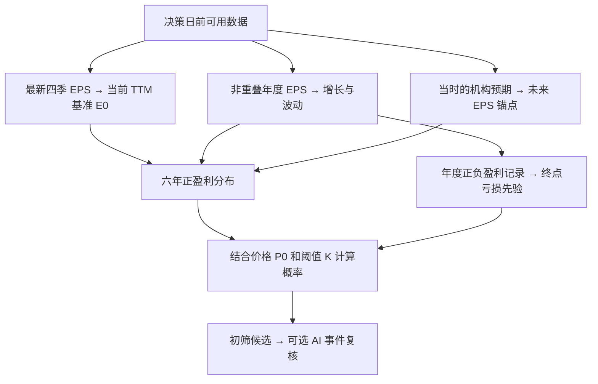

# 当前模型的数据与计算拆解

本文对应 `src/stocking/model.py` 的基准、概率与事件调整逻辑，以及 TTM 输入。讨论范围只包括盈利、价格和已有概率模型；没有新增现金流、债务或融资风险模型。代码检查通过与数据补齐，都不等于概率已经校准。

**后续更新：年度历史已补齐一部分。** 下文第5、6、10、12节中的CLF三年数值保留为“仅把起点换成TTM”的旧对照，不是当前默认面板。现默认通过 `stocking.history` 跨申报接入年度历史：245家公司新增496个年度观察，CLF由2009—2011扩至2001—2011年；完整覆盖仍有限，见 [补样本报告](../reports/annual_history_expansion.md)。CLF的TTM起点仍是6.33，没有用亏损年修改当前EPS。

补齐后的CLF年度EPS依次为：−0.285、−2.325、−0.400、2.950、2.500、2.600、2.570、4.760、1.630、7.490、11.480。负值不能参与正盈利对数增长，故11个年度产生7条有效增长率；历史权重变为7/13，增长中心约0.039594，历史波动约0.642024。三次非正年度使终点亏损先验变为(3+0.6)/(11+10)=17.14%。本轮25%排除线不会排除CLF，但其已不满足原买入条件的10%亏损上限。模型默认参数没有调高或调低。

同一TTM起点下，补齐后的 `P(E6>P0/6)` 为13.22%，`P(E6>P0/8.5)` 为16.65%；旧三年历史对应57.08%和71.29%。更长样本大幅提高波动，同时降低增长中心，因此不能只把变化归因于亏损先验。完整前后结果见[对照报告](../reports/history_expansion_impact.md)，不把这一案例当作模型已验证。

## 1. 最终想计算什么

设决策日价格为 $P_0$，决策日六年后的完整十二个月每股收益为 $E_6$，估值阈值为 $K$。模型计算：

$$
p_K=\Pr(E_6>P_0/K).
$$

当未来盈利为正时，这等价于 `P0/E6 < K`。例如买入价格 38.56 美元：

| 估值阈值 K | 需要达到的六年末 EPS |
|---:|---:|
| 6 | 高于 6.4267 美元 |
| 8.5 | 高于 4.5365 美元 |

“阈值 6”限定盈利要求，“概率至少 70%”限定模型对达到该要求的判断，两者是不同参数。提高 K 会降低所需 EPS，因此在同一盈利分布下，达标概率必然上升。

它没有直接预测六年后的交易价格 $P_6$，也没有计算六年累计 EPS。盈利达标概率与价格上涨概率并不相同。

## 2. 实际输入了哪些数据

| 数据 | 在模型中的作用 | 2012 研究的现状 |
|---|---|---|
| 证券身份、名单及决策日 | 确定分析对象和可用信息边界 | 历史名单为 500 只；不能改用今天的幸存公司名单 |
| 决策日价格 `price`、`price_date` | 计算盈利门槛 $P_0/K$ | 500 条基金持仓估值除以持股数得到的价格，不全部等同于独立核验的交易所收盘价 |
| 最新完整十二个月 EPS `eps0` | 未来盈利路径的起点 | 原研究主要使用最新年报；新输入支持最新 TTM，CLF 已补四个实际季度 |
| EPS 期末、起始日、公开日及来源 | 判断期间是否完整、当时是否可知、数据是否过时 | 新 TTM 输入保留各组成季度证据；不能用后来公布的年报倒填 |
| 历史年度 EPS `history` | 估计增长中心、历史波动、历史亏损频率 | 最多取 11 个年度；大多数原样本只有 3 个年度 |
| 机构 EPS 均值、目标期末、公开日、分析师数 | 提供未来盈利水平锚点及融合权重 | 本次 2012 样本没有历史机构共识 |
| 机构预测标准差 `eps_std` | 为预测不确定性提供一个下限参考 | 缺失时标记，不用零冒充已知 |
| AI 事件的来源、日期和数值调整 | 调整初筛候选的增长、不确定性和终点亏损先验 | 这轮历史回退样本没有运行 AI 事件调整 |
| 币种、会计和股份口径 | 避免 GAAP/调整后、基本/稀释、拆股前后混算 | 当前仅支持 USD；多数批量样本股份口径仍是明确标注的研究假设 |

原年度研究中有 462 只成功计算概率。这个数字属于旧年度输入，不能写成 462 只最新 TTM 已经齐备。现有原始批量 EPS 查询只取了年度事实；季度申报目录存在，不表示目录里的季度 EPS 已下载和归一化。

这些输入也没有包含股价技术指标、行业分类模型、商品价格预测或现金流模型。

## 3. TTM 具体改变什么

本轮采用的季度求和口径为：

$$
E_0^{TTM}=EPS_{q-3}+EPS_{q-2}+EPS_{q-1}+EPS_q.
$$

必须是四个连续、不重叠的真实单季度数字，期间合计约一年，且全部在决策日前公布。不能把六个月或九个月累计 EPS 当作单季度数再相加。

数据接口也允许有来源的直接 TTM 披露，或把确实仍是最新完整期间的年度报告作为 TTM。后者必须明确声明最新已披露期末与年报期末一致；如果已经公布更新季度，不能继续用旧年报冒充最新 TTM。期间支持完整日历年及 52/53 周财政年。程序校验输入所声明的日期与证据结构，不能自行证明外部申报目录已经完整。

新输入通过 `eps_measure="ttm"` 区分期间口径，并保留 `eps_period_start` 和 `ttm_provenance`。`eps_basis` 表达 GAAP/调整后及稀释等会计口径，`share_basis` 表达股份口径。只在旧的自由文本标签里写上“TTM”，不会自动获得 TTM 校验。

CLF 在 2012 年末可用的四个季度是：

| 期间 | 已公布单季稀释 EPS（美元） | 公开日期 |
|---|---:|---|
| 2011 Q4 | 1.30 | 2012-02-15 |
| 2012 Q1 | 2.63 | 2012-04-25 |
| 2012 Q2 | 1.81 | 2012-07-25 |
| 2012 Q3 | 0.59 | 2012-10-24 |
| 合计 | **6.33** | 最后一条于 2012-10-24 可用 |

逐项来源见 [TTM 输入证据](../data/research_2012_ttm_anchors.json)。因此新基准覆盖 2011-10-01 至 2012-09-30，`eps_period_end` 改为 2012-09-30。原基准 11.48 对应 2011 年度。

四季 EPS 求和是透明的 TTM 研究近似，不能称为重新核算的严格全年 GAAP 稀释 EPS：各季加权平均股数可能不同，稀释/反稀释检验也可能随期间损益改变。完整重算还需相应的利润分子、股份和潜在稀释证券资料。这里保留方法和近似限制，不假装这些资料已经齐备。

之前的 `11.48−10.22+5.04=6.30` 是“年度＋当年累计−上年同期累计”的另一种近似。本轮既然取得实际单季度数字，就使用 6.33，不沿用 6.30。

**TTM 只更新当前盈利起点和对应时间，年度历史仍保持真实原值。** CLF 的 `history` 仍为 2009—2011 年的 1.63、7.49、11.48，不把它们整体缩放，也不把 2012 Q3 TTM 追加成一个独立年度样本。

如果按季度滚动生成 TTM，相邻两个观察共享三个季度。把它们当作独立年份会重复计算信息，污染增长波动及亏损次数。此前用于敏感性分析的“全部 EPS 等比例缩放”只是隔离盈利水平影响的反事实，不是正式 TTM 更新方法。

## 4. 哪些数字来自数据，哪些是人为设定

当前程序是可审计的参数化概率模型，没有用历史收益或六年后 EPS 自动训练权重。以下数值是研究默认值：

| 参数 | 默认值 | 含义 |
|---|---:|---|
| 长期对数增长 $g_\infty$ | 0.04 | 远期增长回归目标，普通复合增长约为 $e^{0.04}-1=4.08\%$ |
| 历史收缩强度 | 6 | 把少量历史增长向长期增长收缩 |
| 历史增长波动下限/上限 | 0.20 / 0.80 | 对历史估计做保守边界处理，但该边界尚未校准 |
| 相邻年度误差相关参数 $\rho$ | 0.35 | 预测误差在相邻年份间具有延续性 |
| 持续增长误差标准差 $\tau$ | 0.08 | 所有年份共同受到的长期判断误差 |
| 机构权重下限/上限 | 0.70 / 0.95 | 机构存在时以其预测为主，同时保留历史路径 |
| 机构权重中的先验人数 | 2 | 权重公式的收缩参数，不是真实额外分析师 |
| 增长回归时间尺度 | 2 年 | 超出最后预测锚点后，增长以指数形式回归 |
| 终点非正盈利概率先验 | 6% | 无足够历史时的终点状态起点 |
| 亏损先验样本强度 | 10 | 历史正负盈利频率向 6% 收缩的强度 |
| 买入/卖出复核概率线 | 70% / 80% | 对模型概率的筛选标准 |
| 买入允许的最高亏损概率 | 10% | 初筛买入复核条件 |
| 本轮批量研究的高亏损排除线 | 25% | 排除正盈利模型测试；其他缺数据股票保留状态记录 |
| 价格最大陈旧天数 | 7 日 | 相对决策日检查价格日期 |
| TTM 最大陈旧天数 | 200 日 | 相对决策日检查 TTM 期末；旧年度兼容输入仍为 550 日 |
| 机构预期最大陈旧天数 | 180 日 | 相对决策日检查共识公开日期 |

“数据里有三年连续盈利”是观测；“由此结合 6%、10 个先验样本得到 4.62%”是模型推算；“4.62% 是未来六年的真实概率”则没有被验证。

## 5. 第一步：从年度 EPS 提取增长

先去掉决策日后才公开的历史记录；同一年度存在多个版本时，选决策日前最新公开的版本。同一期间、同一公开日却出现矛盾数值，会报错。保留最近最多 11 个年度。

相邻两个年度都为正盈利，且期末相隔约 0.75—1.25 年，才计算增长：

$$
g_i=\operatorname{clip}\left(\frac{\ln(E_i/E_{i-1})}{\Delta t_i},-1,1\right),
\qquad \Delta t_i=\frac{\text{相隔天数}}{365.2425}.
$$

这是年化对数增长。例如 EPS 从 10 增到 11，普通增长为 10%，对数增长为 $\ln(1.1)\approx9.53\%$。负盈利不能取对数，因此亏损年份不会被转成虚构的增长率，但会保留在亏损频率里。

若有 $n$ 条有效增长率，历史增长中心为：

$$
\alpha=\frac{n}{n+6},\qquad
h=\alpha\operatorname{median}(g_i)+(1-\alpha)\times0.04.
$$

这里的历史权重依赖有效增长率条数，不是总财报条数。CLF 三个年度只能形成两条增长率，故历史权重为 $2/(2+6)=25\%$。两条截断后的增长约为 1.0000 和 0.4273，中位数约 0.7137，所以：

$$
h\approx25\%\times0.7137+75\%\times0.04=0.2084.
$$

这个数是 **20.84% 的对数增长中心**，不是 20.84% 的普通增长，也不是保证连续六年维持这一增长。模型随后会使增长回归长期值。

更新 CLF 的 TTM 基准不会自动重估上述年度增长中心，因为年度历史没有改变。因此仅更新 TTM 解决的是起点陈旧问题，没有加入行业周期均值回归模型。

## 6. 第二步：给增长设置不确定性

先对历史增长率取样本标准差：

$$
\sigma_{hist}=\begin{cases}
\min(0.80,\max(0.20,\operatorname{sd}(g_i))),&n\ge3,\\
0.20,&n<3.
\end{cases}
$$

程序的一个重要现状是：不足三条增长率时，直接使用 0.20，而不是可靠地估计出了 20% 的波动。CLF 仍有两条增长率，所以更新 TTM 后该参数不变。

如果机构给出了 EPS 均值 $C_t$ 与分歧标准差 $S_t$，则还计算：

$$
\sigma_{cons,t}=\sqrt{\frac{\ln(1+(S_t/C_t)^2)}{t}},\qquad
\sigma=\max(\sigma_{hist},\sigma_{cons,1},\ldots).
$$

其中 $t$ 是基准 EPS 期末到机构目标期末的年数。0.80 是历史估计环节的上限；后续机构分歧可以把最终 $\sigma$ 提高到这个数以上。

分析师分歧不能除以分析师人数的平方根：多人可能同时犯方向一致的错误。分析师数用于下一步的权重，不会让这里的不确定性机械地趋近于零。

## 7. 第三步：机构预期与历史路径怎样融合

对一个有 $N_t$ 位分析师的目标期，机构权重是：

$$
w_t=\operatorname{clip}\left(\frac{N_t}{N_t+2},0.70,0.95\right).
$$

| 分析师数 | 机构权重 | 历史路径权重 |
|---:|---:|---:|
| 1 | 70.00% | 30.00% |
| 5 | 71.43% | 28.57% |
| 10 | 83.33% | 16.67% |
| 20 | 90.91% | 9.09% |
| 38 及以上 | 95.00% | 5.00% |

首先用当前基准和历史增长构造 $H_t=E_0e^{ht}$。然后采用几何混合：

$$
M_t=C_t^{w_t}H_t^{1-w_t},
$$

等价地，

$$
\ln(M_t/E_0)=w_t\ln(C_t/E_0)+(1-w_t)ht.
$$

这不是直接做 `机构EPS×权重＋历史EPS×权重` 的算术平均。例如机构预测 10、历史路径为 8、权重 80%，则混合值约为 $10^{0.8}8^{0.2}=9.56$。

$M_t$ 被用作“未来为正盈利条件下的 EPS 均值锚点”。机构权重是设计参数，不代表分析师预测有对应比例的正确率。

当前 2012 研究没有历史机构共识，因此上述机构权重分支没有实际参与。其概率来自下一节的历史回退路径。

## 8. 第四步：把几个锚点延伸为六年盈利路径

锚点之间按 EPS 水平的对数作线性插值。这样避免把 FY1、FY2 当作恰好距决策日一年、两年，而是按它们的实际财政期末定位。

超出最后一个锚点后，取最后相邻锚点的对数增长率 $g_L$，截断到 $[-0.50,0.50]$。没有机构锚点时，使用截断后的 $h$。在最后锚点之后再经过 $u$ 年，均值路径为：

$$
\ln\frac{M_{L+u}}{M_L}
=g_\infty u+(g_L-g_\infty)a(1-e^{-u/a}),
\quad g_\infty=0.04,\ a=2.
$$

其瞬时增长为 $g_\infty+(g_L-g_\infty)e^{-u/a}$：初期接近最后增长率，之后逐步接近长期增长。**这是增长率回归，不是盈利水平回归到行业周期平均值。**

没有机构共识时，从 $E_0$ 开始直接应用该公式。CLF 的较高历史反弹增长仍会短期影响路径，但不会原样外推全部六年。

预测的六个输出日期固定为决策日加 1 至 6 个日历年。由于基准 EPS 期末早于决策日，第一段还包含这段已过去但盈利尚未完整观测的桥接期。

以 CLF 为例，决策日为 2012-12-31，终点固定 2018-12-31：

| 基准 | 基准期末到第一个目标日 2013-12-31 | 基准期末到六年目标 |
|---|---:|---:|
| 原 2011 年度 EPS | 约 2 年 | 约 7 年 |
| 新 2012 Q3 末 TTM | 约 1.25 年 | 约 6.25 年 |

所以更新 TTM 不只是把 11.48 换成 6.33，还会改变预测覆盖的总时长和不确定性。

## 9. 第五步：把均值路径变成概率分布

用 $d_i$ 表示第 $i$ 段的年长，$x_i$ 表示该段的年化对数增长。模型假设六段增长联合服从正态分布：

$$
\mathbf{x}\sim N(\mathbf{m},C),\qquad
C_{ij}=\frac{\sigma^2\rho^{|i-j|}}{\sqrt{d_id_j}}+\tau^2,
\quad \rho=0.35,\ \tau=0.08.
$$

第一部分表示预测误差会跨年延续，相隔越远相关性越低；第二部分表示所有年份都可能受到同一个长期判断错误的影响。因此不能把六年当成六个相互独立的随机增长。

到第 $i$ 个目标日的累计对数方差为：

$$
V_i=\sum_{j\le i}\sum_{k\le i}d_jd_kC_{jk}.
$$

为了让已确定的 $M_i$ 真正对应正盈利条件下的算术均值，设置：

$$
m_i=\frac{\ln(M_i/M_{i-1})-\tfrac12(V_i-V_{i-1})}{d_i},
\quad M_0=E_0,\ V_0=0.
$$

减去半个方差增量是对数正态分布的均值修正。如果不做这个修正，单纯增大波动就会把期望 EPS 自动抬高。

最终，条件于六年末为正盈利：

$$
\ln E_6\sim N(\mu,V),\qquad
\mu=\ln E_0+\sum_i d_im_i,\quad V=V_6.
$$

由此得到：

| 输出 | 公式 | 含义 |
|---|---|---|
| 正盈利条件均值 | $e^{\mu+V/2}$ | 对数正态右尾会拉高均值 |
| 正盈利条件中位数 | $e^\mu$ | 正盈利分支中一半结果在其两侧 |
| 正盈利条件 90% 区间 | $[e^{\mu+\sqrt V\Phi^{-1}(0.05)},e^{\mu+\sqrt V\Phi^{-1}(0.95)}]$ | 模型分布的区间，不是已验证的覆盖保证 |

年度表中的普通增长均值是 $e^{m_i+C_{ii}/2}-1$，方差是 $(e^{C_{ii}}-1)e^{2m_i+C_{ii}}$。这些也条件于正盈利分支，不能把对数增长直接当作普通增长。

## 10. 第六步：另算终点亏损概率

正的对数正态 EPS 永远不会变成负数，因此程序另设终点非正盈利分支。若历史有 $H$ 个年度，其中 $L$ 个年度 EPS≤0：

$$
p_{loss}=\frac{L+0.06\times10}{H+10}=\frac{L+0.6}{H+10}.
$$

CLF 三个历史年度均为正，故 $p_{loss}=0.6/13=4.6154\%$。TTM 更新没有增加年度样本或改变历史正负号，所以这个数仍不变。

它表示的是“六年末 EPS≤0”的未校准先验，不是六年内至少亏过一次、破产、股价下跌或发生永久资本损失的概率。2018 年仍盈利而股价大跌，与这个事件定义并不矛盾。

模型不刻画亏损金额，所以只能输出正盈利条件下的 EPS 均值，不能把它宣称为混合了亏损状态的无条件 EPS 均值。

当前基准 EPS≤0 或有效机构预测 EPS≤0 时，模型返回 `abstain`。它没有实现专门的扭亏预测。

## 11. 第七步：计算阈值概率与筛选状态

用 $\Phi$ 表示标准正态累计分布函数，则：

$$
p_K=(1-p_{loss})\left[1-\Phi\left(\frac{\ln(P_0/K)-\mu}{\sqrt V}\right)\right].
$$

先在正盈利分布中计算超过门槛的比例，再乘以处于正盈利状态的概率。这一步直接用正态分布函数求值，没有做蒙特卡洛抽样。

固定阈值 6 与 6.5 把结果分成四类：

| 字段 | 事件 |
|---|---|
| `p_below_6` | $E_6>P_0/6$ |
| `p_above_6_5_positive` | $0<E_6<P_0/6.5$ |
| `p_between_6_6_5` | 正盈利且位于两个门槛之间 |
| `p_loss` | $E_6\le0$ |

四项合计为 1。第二项没有再除以正盈利概率，因此不是一个条件概率。

默认初筛买入研究要求 `p_below_buy_threshold≥70%` 且 `p_loss≤10%`；卖出复核要求正盈利高估概率≥80%或 `p_loss≥25%`。缺机构共识时，默认仍计算概率但不进入 AI 队列。全名单研究按用户要求另采用 25% 的高亏损排除线，不因没过 70% 就从主表删掉。

配置 K=8.5 后，应读取可配置的阈值字段。`p_below_6` 始终表示固定 6，不会随配置改名换义。

## 12. CLF 更新前后，哪些变化、哪些没变

| 项目 | 原年度输入 | 新四季求和 TTM 输入 |
|---|---:|---:|
| 当前盈利起点 | 11.48 | 6.33 |
| 盈利期末 | 2011-12-31 | 2012-09-30 |
| 历史年度 EPS | 1.63、7.49、11.48 | 保持原样 |
| 有效增长率数量 | 2 | 2 |
| 历史对数增长中心 | 0.208415 | 0.208415 |
| 历史波动参数 | 0.20 | 0.20 |
| 终点亏损概率 | 4.62% | 4.62% |
| 正盈利终点 EPS 均值 | 21.06 | 11.22 |
| 正盈利终点 EPS 中位数 | 14.09 | 7.91 |
| 阈值 6 达标概率 | 77.20% | 57.08% |
| 阈值 8.5 达标概率 | 85.55% | 71.29% |

这里的新结果按 6.33 和真实 TTM 期末计算，年度历史保持原样。它不同于先前“缩放全部历史、保留旧时间”的敏感性情景。TTM 让 CLF 不再通过阈值 6 的 70% 概率条件，但阈值 8.5 仍略高于 70%。这说明更换盈利基准不等于自动识别全部周期风险。

## 13. AI 到底调整什么

AI 事件只对已进入初筛复核的候选生效，基准模型不会自动读新闻。每个事件必须提供决策日前 180 日内的公开日期、来源、摘要、推理以及：

| 参数 | 单事件范围 | 多事件合计限制 |
|---|---|---|
| 六个年度的对数增长增量 | 每年 −0.10 至 +0.10 | 置信权重加权后，每年 −0.20 至 +0.20 |
| 方差倍数 | 1 至 3 | 加权相乘后不超过 3 |
| 终点亏损概率增量 | −0.10 至 +0.20 | 加权后 −0.10 至 +0.25 |
| 事件置信权重 | 0 至 1 | 用于把事件幅度向零收缩 |

若事件已经包含在共识中，增量必须为零。增长调整以各年事件增量乘置信权重后相加；方差倍数按 `各倍数^置信权重` 相乘；亏损增量也按置信权重相加，调整后亏损概率截在 1%—95%。

方差提高时，程序同步修正对数均值，保证“不确定性上升”本身不会自动提高期望盈利。增长增量仅作用于决策日之后的六年，不回头修改已过去的桥接期。所有事件必须一次性施加到原基准，不能反复叠加。

这些限制控制幅度与可追溯性，并不能验证 AI 的事实判断正确。`confidence` 是收缩权重，不是经历史数据校准过的 AI 正确率。本次 2012 样本没有机构共识，默认没有进入这个环节。

## 14. 10% 年化收益与 K 的关系

如果额外假设六年后的交易市盈率为 $M=P_6/E_6$，忽略分红和费用，则：

$$
P_6=M E_6,\qquad
\frac{P_6}{P_0}=\frac{M}{P_0/E_6}.
$$

要达到年化价格收益 $r$，所对应的估值边界是：

$$
K=\frac{M}{(1+r)^6}.
$$

例如用户选定 $r=10\%$，假定退出估值 $M=15$，则 $K\approx8.47$。这只是把收益目标换算成盈利门槛；当前模型没有预测 $M$ 的分布，所以不能把 `p_below_8.5` 直接称为“六年年化回报超过 10% 的概率”。

## 15. 当前结果的适用边界

新 TTM 基准减少了盈利起点滞后，但历史增长仍使用年度数据，波动及亏损先验的默认设定也没有经过全样本校准。缺少历史机构共识时，名义上的“机构为主”分支不会发生；缺少六年后同口径结果标签，也不能检验 70% 预测组是否约有 70% 真正实现盈利事件。

本轮保留原年度研究，新增 TTM 输入和输出，数据缺口明确记录。更改输入口径不把四只或一只案例自动升级为全市场验证，也不根据 CLF 的事后表现反向拟合参数。
