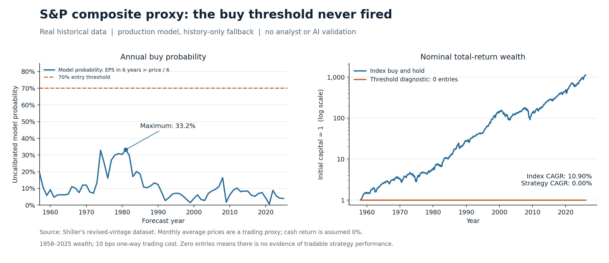

# 历史验证：指数级代理，不是完整选股回测

**结论：该实验不能证明标普500个股、机构共识或AI事件调整策略可靠。它用真实历史数据检验生产模型的纯历史回退分支，并检查固定阈值在指数级代理上的行为。**

数据来自 [Robert Shiller 官方页面](https://shillerdata.com/) 的 [ie_data.xls](https://img1.wsimg.com/blobby/go/e5e77e0b-59d1-44d9-ab25-4763ac982e53/downloads/1449043e-a1ed-4e2e-8e9c-7b9a2a064493/ie_data.xls?ver=1791297298731)。下载时间：2026-11-06T05:30:21.827437+00:00；SHA-256：`98a54927942e842ec07ffe73000998e793953708c345b6b27bb363e9ada8366a`。

采用1926年以后历史盈利、1957年以后每年12月预测；只使用预测年前一年12月及更早的盈利，并假定次年6月底可获得（保守约一年滞后）。六年终点是预测年+6的12月。机构预测为空；没有使用或生成历史AI事件判断。输入是指数点数，不是某家公司的EPS。

价格为12月月均价；盈利为四季合计及插值序列；工作簿为现行修订版本，不含当时版本。因此虽然计算严格截断未来记录，不能消除修订和插值信息污染。只保留截至2025年12月的完整年度，排除2026年暂估数据。

模型参数使用程序默认值，没有用测试结果优化。概率基准只使用已成熟六年结果并额外等待一年，至少10个成熟标签；基准为加一平滑的历史事件率。六年窗口重叠，95%区间使用长度6的循环移动块bootstrap（2000次），不是独立样本置信区间；仅少量历史块、分布变化和修订数据会削弱区间可信度。

共同评分期：1973–2019；47次年度预测，约7个互不重叠六年块。

| 六年结果事件 | 次数 | 模型Brier（越低越好） | 因果历史频率基准 | 模型减基准的95%块bootstrap区间 |
|---|---:|---:|---:|---|
| 0 < P₀/EPS₆ < 6 | 4 | 0.0583 | 0.0847 | [-0.0599, -0.0058] |
| P₀/EPS₆ > 6.5，且EPS₆ > 0 | 42 | 0.0758 | 0.1075 | [-0.0773, -0.0022] |

正盈利条件下90% EPS区间覆盖率：97.9%。指数历史盈利均为正，不能检验个股亏损/退市概率。各概率分箱的实际发生率和六种非重叠抽样结果见 `historical_metrics.json`；小样本分箱不支持概率校准结论。

## 简化交易诊断

每年12月信号，次年1月月均价代理成交；持仓从1月至2月的收益区间开始生效，避免用信号形成当月收益。买入概率≥70%进入指数；高估概率≥70%退出，之间保持持仓。初始现金，现金收益0；每次单向换仓收10基点成本。使用原始工作簿实际提供的实质总回报指数乘CPI还原名义总回报比例。没有融资、卖空或调参。月均价不能实际执行，现金0收益也不是真实货币市场收益，所以以下是机制诊断。

期间：1958-01-31 至 2025-12-31。

| 指标 | 阈值策略 | 指数买入持有 |
|---|---:|---:|
| 年化收益 | 0.00% | 10.90% |
| 最大回撤 | 0.00% | -49.04% |
| 期末净值（初始1） | 1.00 | 1125.95 |

开仓0次，持仓变化0次；持股月占比0.0%。所有年度买入概率最高仅33.2%。**零成交并不是低风险策略获胜，而是这套阈值在本指数代理上没有产生可验证的买卖。**

此处为阈值机制诊断：主动允许历史回退结果参与交易，并统一买卖门槛70%；正式程序默认禁用缺少共识的候选，且默认卖出门槛80%，因此不能把诊断称为默认生产策略回测。60%/70%/80%门槛、0/10/25基点成本，以及年度波动下限15%/20%/30%、长期对数增长2%/4%/6%的预设敏感性结果均保留在JSON；不能挑选最佳组合后作为样本外证据。

## 不能由本报告推出的结论

没有验证500只股票的横截面排序、当期成分股/退市收益、机构共识历史快照、AI事件调整的增量收益、行业风险或真实可交易收益。指数聚合会大幅平滑个股风险，而且成分变更使指数盈利不等同于一直持有一组固定公司。完整验证需要点时成分、原始公告版本、历史共识、拆股/分红/退市数据，以及只在训练窗内估计的误差和相关性。将AI分析应用到过去还会受到语言模型训练记忆的污染，应优先做冻结版本的前瞻纸面测试。

现有证据只支持将工具作为研究筛选器；概率仍是模型输出。固定6/6.5阈值与收益之间并没有定义上的必然关系，也不保证未来股价或退出倍数。

复现：`python scripts/validate_history.py`（使用缓存）或 `python scripts/validate_history.py --download`（重新下载，URL版本变更需审阅）。
